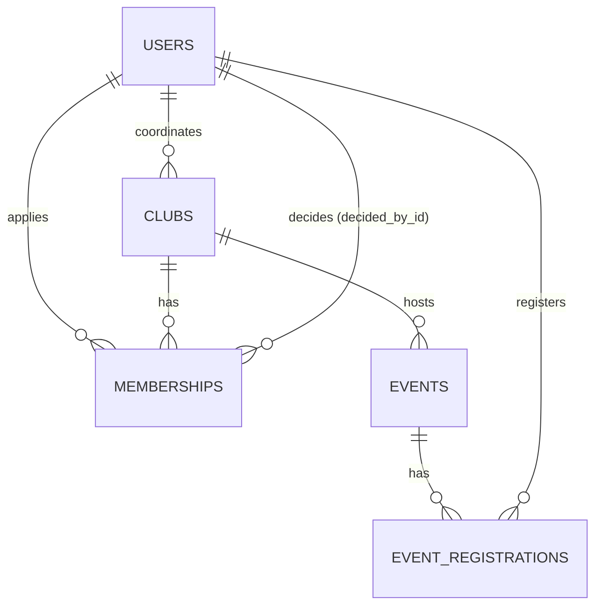

# Club Registration Portal

A full-stack web app for college clubs. Students discover clubs, apply to join, and register for club events.
Coordinators review applications and run their clubs. Admins create clubs and manage the portal.


## 🌐 Live demo

| | Link |
|---|---|
| **Website** | https://club-registration-portal.vercel.app |
| **Backend API** | https://club-portal-api.onrender.com/api/health |

Demo logins:

| Role | Email | Password |
|---|---|---|
| Admin | admin@college.edu | Admin@123 |
| Coordinator | arjun.coord@college.edu | Coord@123 |
| Student | student@college.edu | Student@123 |

> The backend runs on Render's free plan. It sleeps after 15 minutes of no use, so the first login can take about a minute.
> Demo data resets whenever the backend restarts.


| Layer    | Tech |
|----------|------|
| Frontend | React 19 (Vite), React Router, Axios, **plain CSS** |
| Backend  | Java 17, Spring Boot 3.3, Spring Web, Spring Data JPA (Hibernate), Spring Security + JWT, Bean Validation |
| Database | MySQL 8 |
| DevOps   | Docker, Docker Compose, nginx |

---

## Features

**Students**
- Sign up / log in (JWT, BCrypt-hashed passwords)
- Explore clubs: search, filter by category, "open for registration" filter, live seat count
- Apply to a club with a short motivation; withdraw a pending application or leave a club
- Membership limit: at most **3 clubs at a time** (pending applications count too)
- Register for club events (some are **members-only**), cancel the registration
- "My clubs" page with status history and the coordinator's remarks

**Coordinators**
- Dashboard of the clubs they run, applications waiting, upcoming events
- Approve / reject applications (rejecting needs a reason), remove members
- Edit club details, open / close registrations, change capacity
- Create and cancel events, see who registered

**Admins**
- Portal-wide dashboard: clubs, students, memberships, pending applications, members by category
- Create clubs, assign coordinators, edit any club
- Create coordinator / admin accounts, disable or enable users

**Under the hood**
- Capacity can never be exceeded: approvals and event registrations lock the row (`SELECT … FOR UPDATE`) before checking seats
- `UNIQUE` constraints stop duplicate applications and duplicate event registrations
- One consistent error format: `{"error": "...", "message": "..."}` — never a stack trace
- Responsive layout (works on phones)

### Membership workflow

```
                 coordinator / admin
  apply ──► PENDING ─────────────► APPROVED ──► LEFT      (student leaves)
               │   └────────────► REJECTED     └─► REMOVED (coordinator removes, reason required)
               └──► WITHDRAWN (student cancels)
  Any inactive status can apply again → back to PENDING (same row is reused)
```

---

## Project structure

```
club-registration-portal/
├── backend/                         Spring Boot REST API (port 8080)
│   ├── pom.xml
│   └── src/main/java/com/clubportal/
│       ├── controller/              REST endpoints (HTTP in/out only)
│       ├── service/                 Business rules (AccessPolicy = who manages a club)
│       ├── repository/              Spring Data JPA repositories (incl. row-locking queries)
│       ├── model/                   JPA entities (tables)
│       ├── dto/                     Request / response objects + validation rules
│       ├── security/                JWT service + filter, JSON 401/403 handlers
│       ├── exception/               ApiException + GlobalExceptionHandler
│       └── config/                  SecurityConfig, DataSeeder (demo data)
│   └── src/main/resources/
│       ├── application.properties       MySQL settings + club limit
│       └── application-h2.properties    optional: run without MySQL
├── frontend/                        React app (port 5173)
│   ├── vite.config.js               forwards /api → http://localhost:8080
│   └── src/
│       ├── api/                     Axios client + API functions
│       ├── context/                 AuthContext (login state), ToastContext
│       ├── components/              Layout (top nav), club & event cards, badges, tabs…
│       ├── pages/                   Login, Register, Home, Clubs, Club detail, Events, My clubs, Admin
│       ├── styles/                  theme.css, layout.css, components.css, pages.css
│       └── utils/                   formatting, validation, RSVP hook
└── database/schema.sql              MySQL schema (reference — tables are auto-created)
```

---

## How to run (Windows — VS Code terminal / PowerShell)

### 0. Install once
- **Java 17 or newer** (JDK) — check: `java -version`
- **Maven** — check: `mvn -v` (or use IntelliJ IDEA, which has Maven built in)
- **Node.js 18 or newer** — check: `node -v`
- **MySQL 8** (optional — see the no-MySQL option below)

> Always `cd` into the right folder first: Maven commands run inside **`backend`**, npm commands inside **`frontend`**.

### 1. Backend (terminal 1)

**Without MySQL (quickest — data resets when you stop it):**
```powershell
cd "C:\path\to\club-registration-portal\backend"
mvn spring-boot:run "-Dspring-boot.run.profiles=h2"
```

**With MySQL (data is saved):**
```powershell
cd "C:\path\to\club-registration-portal\backend"
$env:DB_USERNAME="root"
$env:DB_PASSWORD="your_mysql_password"
mvn spring-boot:run
```
The `club_portal` database, all tables and the demo data are created automatically on the first run.

Wait for `Started ClubPortalApplication`, then check http://localhost:8080/api/health → `{"status":"UP"}`.
Keep this terminal open.

### 2. Frontend (terminal 2 — click **+** in VS Code)
```powershell
cd "C:\path\to\club-registration-portal\frontend"
npm install
npm run dev
```
Open **http://localhost:5173**

> Using the classic **Command Prompt** instead of PowerShell? Use `set DB_PASSWORD=your_mysql_password`
> instead of `$env:DB_PASSWORD="..."`, and `mvn spring-boot:run -Dspring-boot.run.profiles=h2` (no quotes needed).

### Demo logins

| Role        | Email                     | Password    | Notes |
|-------------|---------------------------|-------------|-------|
| Admin       | admin@college.edu         | Admin@123   | everything |
| Coordinator | arjun.coord@college.edu   | Coord@123   | runs Coding Club & Robotics Club |
| Coordinator | meera.coord@college.edu   | Coord@123   | Music Club, Dance Crew, Drama Society |
| Coordinator | vikram.coord@college.edu  | Coord@123   | Cricket, Chess, NSS Volunteers |
| Student     | student@college.edu       | Student@123 | member of Coding Club, Music Club pending |
| Student     | kiran@college.edu         | Student@123 | already at the 3-club limit |
| Student     | aisha@college.edu         | Student@123 | one rejected application |

The login page has one-click buttons for a student, a coordinator and the admin.

### Quick demo flow
1. Log in as **student** → Explore clubs → **Dance Crew** → write why you want to join → *Send application*
2. Log out, log in as **meera.coord** → Home shows the application → **Approve**
3. Log in as **student** again → Dance Crew now says *You're a member* → Events → register for an event
4. Log in as **kiran** → try to apply to another club → blocked by the 3-club limit

### Run the backend tests
```powershell
cd "C:\path\to\club-registration-portal\backend"
mvn test
```
12 end-to-end API tests run against an in-memory database (no MySQL needed): login errors, validation,
apply → approve → leave → re-apply, rejection reasons, club limit, closed registrations, capacity,
members-only events, double registration, role checks and dashboards.

---

## Run with Docker

Runs MySQL, the Spring Boot backend and the React frontend together - no Java, Maven, Node or MySQL
needed on your machine, only **Docker Desktop**.

```powershell
docker compose up -d --build
```

| What | Where |
|------|-------|
| App | http://localhost:3000 |
| API health | http://localhost:8080/api/health |
| Demo login | admin@college.edu / Admin@123 (all demo logins are listed above) |

The first build takes a few minutes. Data is kept in the `db-data` volume between restarts.

```powershell
docker compose ps          # see the 3 containers
docker compose logs -f backend   # watch backend logs (Ctrl+C to stop watching)
docker compose down        # stop everything (data is kept)
docker compose down -v     # stop and delete the database too
```

### Docker Hub images

| Image | Link |
|-------|------|
| Backend (Spring Boot) | https://hub.docker.com/r/bhanudocker0318/club-portal-backend |
| Frontend (React + nginx) | https://hub.docker.com/r/bhanudocker0318/club-portal-frontend |

Run the published images without building (needs the `docker-compose.yml` from this repo):

```powershell
$env:DOCKERHUB_USER="bhanudocker0318"
docker compose pull backend frontend
docker compose up -d --no-build
```

### How the containers talk to each other

```
Browser ──► frontend (nginx :80, published as :3000) ──/api/*──► backend (Spring Boot :8080) ──► db (MySQL :3306)
```

nginx serves the built React files and forwards every `/api/...` request to the `backend` container,
so the browser only ever talks to one address (no CORS issues).

---

## Configuration

`backend/src/main/resources/application.properties` — values can be overridden with environment variables:

| Setting | Default | Meaning |
|---------|---------|---------|
| `DB_URL` | `jdbc:mysql://localhost:3306/club_portal?createDatabaseIfNotExist=true&...` | MySQL connection |
| `DB_USERNAME` / `DB_PASSWORD` | `root` / `root` | MySQL login |
| `JWT_SECRET` | dev value | Secret for signing login tokens — **change it for real use** (32+ characters) |
| `CORS_ORIGINS` | `http://localhost:5173,http://127.0.0.1:5173` | Allowed frontend origins |
| `app.max-active-clubs` | `3` | Max clubs per student (pending + approved) |
| `app.seed.enabled` | `true` | Insert demo data when the database is empty |

Frontend: calls `/api`, which Vite forwards to `http://localhost:8080` (see `frontend/vite.config.js`).
To point it elsewhere, copy `frontend/.env.example` to `frontend/.env` and set `VITE_API_URL`.

---

## Database design



- `users.email`, `clubs.name` are UNIQUE
- `memberships (user_id, club_id)` and `event_registrations (event_id, user_id)` are UNIQUE
- Composite indexes on `memberships (club_id, status)` and `(user_id, status)` for counts; `events (starts_at)` for upcoming lists
- Full DDL: [`database/schema.sql`](database/schema.sql)

---

## REST API

All endpoints except login, register and health need `Authorization: Bearer <token>`.

| Method | Endpoint | Who | Purpose |
|--------|----------|-----|---------|
| POST | `/api/auth/register` | public | Create a student account → token |
| POST | `/api/auth/login` | public | Log in → token |
| GET | `/api/auth/me` | any | Current user |
| GET | `/api/dashboard` | any | Role-specific home page data |
| GET | `/api/clubs` | any | List — `q`, `category`, `openOnly` |
| POST | `/api/clubs` | admin | Create a club |
| GET | `/api/clubs/{id}` | any | Details, my membership, allowed actions, upcoming events |
| PUT | `/api/clubs/{id}` | coordinator of club / admin | Edit (coordinators can't change name, category, coordinator) |
| POST | `/api/clubs/{id}/apply` | student | `{"motivation": "…"}` |
| GET | `/api/clubs/{id}/members` | coordinator of club / admin | Applications & members, `?status=PENDING` |
| GET | `/api/memberships/my` | student | My applications and memberships |
| GET | `/api/memberships/pending` | coordinator / admin | Applications waiting for me |
| PATCH | `/api/memberships/{id}/status` | coordinator of club / admin | `{"status": "APPROVED" \| "REJECTED" \| "REMOVED", "remark": "…"}` |
| POST | `/api/memberships/{id}/leave` | the student | Withdraw application / leave club |
| GET | `/api/events` | any | `scope` = upcoming / past / mine, optional `clubId` |
| POST | `/api/events` | coordinator of club / admin | Create an event |
| POST | `/api/events/{id}/cancel` | coordinator of club / admin | Cancel an event |
| POST / DELETE | `/api/events/{id}/register` | student | Take / release a seat |
| GET | `/api/events/{id}/attendees` | coordinator of club / admin | Who registered |
| GET / POST | `/api/users` | admin | List (`?role=COORDINATOR`) / create accounts |
| PATCH | `/api/users/{id}/status` | admin | `{"active": false}` |
| GET | `/api/health` | public | `{"status":"UP"}` |

### Error format

```json
{ "error": "CLUB_LIMIT_REACHED", "message": "You can be part of at most 3 clubs at a time…", "path": "/api/clubs/4/apply", "timestamp": "..." }
```

| Status | error | When |
|--------|-------|------|
| 400 | `VALIDATION_ERROR` (+ `details` per field), `MALFORMED_REQUEST`, `INVALID_PARAMETER`, `REMARK_REQUIRED`, `INVALID_TIME` | Bad input |
| 401 | `UNAUTHORIZED`, `INVALID_CREDENTIALS` | Not logged in / expired token / wrong email or password |
| 403 | `FORBIDDEN`, `ACCOUNT_DISABLED` | Not allowed for your role, not your club, members-only event |
| 404 | `NOT_FOUND` | Unknown id |
| 409 | `ALREADY_APPLIED`, `ALREADY_MEMBER`, `CLUB_LIMIT_REACHED`, `CLUB_FULL`, `REGISTRATION_CLOSED`, `CAPACITY_TOO_LOW`, `EVENT_FULL`, `ALREADY_REGISTERED`, `EVENT_STARTED`, `EMAIL_ALREADY_EXISTS`, `INVALID_STATE` … | Rule violations and duplicates |
| 500 | `INTERNAL_ERROR` | Unexpected — message has a reference id; details only in the server log |

---

## Troubleshooting

| Problem | Fix |
|---------|-----|
| `No plugin found for prefix 'spring-boot'` | You're not in the `backend` folder — `cd` into it (the one with `pom.xml`) |
| `%USERPROFILE%` path doesn't work | That's Command Prompt syntax; in PowerShell use the full path in quotes |
| `Communications link failure` / `Connection refused` | MySQL isn't running or isn't installed — start the MySQL80 service, or use the `h2` command |
| `Access denied for user 'root'@'localhost'` | Wrong MySQL password — set `$env:DB_PASSWORD="..."` again, then `mvn spring-boot:run` |
| `Port 8080 was already in use` | An old backend is still running: `Stop-Process -Id (Get-NetTCPConnection -LocalPort 8080 -State Listen).OwningProcess -Force` |
| "Can't reach the server" box in the app | The backend isn't running (terminal 1) |
| `npm error ENOENT package.json` | Run npm inside the `frontend` folder |
| `running scripts is disabled on this system` | Use `npm.cmd install` and `npm.cmd run dev` |
